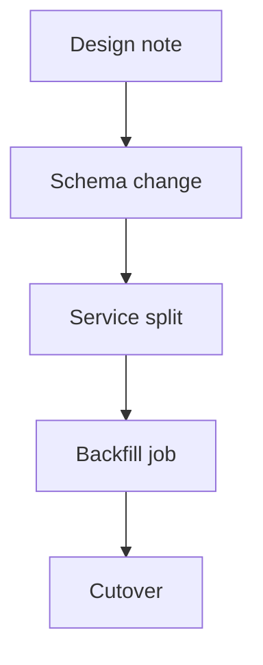

# Worked example: a run with no Linear and no Graphviz

This walks one generic project, `ledger-service`, from prompt to artifacts. The point is the fallback path: no tracker connection, no diagram tool, no publish target. It still ends with a doc and a diagram.

## The prompt

> Map how this repo ships software and make me a diagram I can share.

## Port resolution

| Port | Chosen | Why |
| --- | --- | --- |
| source | docs and git log | No Linear tool is connected |
| diagram | Mermaid | `dot` is not on PATH |
| publish | none | The user asked to share, not to deploy |
| voice | three-line floor | tone-tweaks is not installed |

Provenance lines written into the doc:

```text
Updated: 2026-10-29
Source: docs plus git log (last 50 commits), 2026-10-29
Diagram: Mermaid, renders on GitHub
Voice: built-in three-line floor
Publish: not published
```

## What the source pass produced

`docs/` had a short architecture note. `git log --oneline -50` showed the same names in commit subjects. Reading both gave five phases without a tracker:

1. Design note (done)
2. Schema change (done)
3. Service split (in progress)
4. Backfill job (planned)
5. Cutover (planned)

One clarifying question was enough: whether the design note or the git order was the truer sequence. It is not repeated later.

## The doc

`docs/SDLC_MAP.md` starts with the header above, then one section per phase:

```markdown
## Phase: Schema change

- What: Adds the ledger entry table and its indexes.
- Why: Later phases read and write entries, so the shape has to land first.
- Where: `db/migrations/`, issues not tracked in this repo
- Status: done
```

Every heading is anchored, so a diagram node can point at `#phase-schema-change`.

## The diagram

`docs/sdlc-map.mmd`:



Node labels stay quoted so punctuation cannot break the graph. No rendered image is claimed, because the default path needs none. If the user later wants a picture file, the skill switches to Graphviz, writes `docs/sdlc-map.gv`, and runs `scripts/render.sh`. When `dot` is missing, the `.gv` stays and the doc carries the not-rendered note.

## The page

Publish is left off. If the user then asks for a page, the run writes `site/index.html` and checks three things before any upload:

- every href starts with `https://`
- every phase label is escaped before it goes into markup
- the head carries `<meta name="robots" content="noindex">`

It asks once for the host and target, then records the URL or "not published".

## Final report

The run points at `docs/SDLC_MAP.md` and `docs/sdlc-map.mmd`, pastes the four provenance lines, and lists next steps: review the phase order, decide whether to publish, and link the doc from the README.
